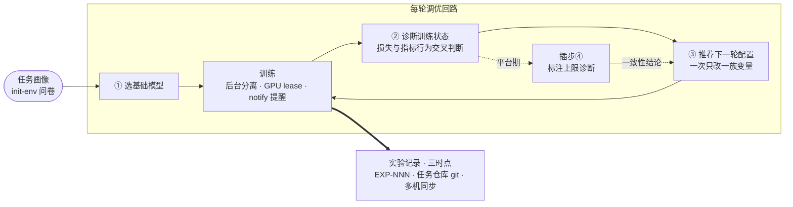

<div align="center">

# MedPowers

**医疗影像小模型训练方法论技能库**

为医疗场景深度学习**小模型**的**训练效率与收敛精度**而建：

> **选基础模型 → 诊断训练状态 → 推荐下一轮配置** 的完整调优闭环，
> 以任务无关的知识资产 + 方法论 + 智能体技能的形式分发。


**41 张论文支撑的资产卡** · **4 篇方法论** · **7 个技能** · **1 套实验记录规范**

[安装](#插件安装仓库即市场) · [安装手册](INSTALL.md) · [核心回路](#核心方法论回路) · [仓库内容](#知识资产四类) · [实验记录规范](#实验记录规范强制三时点git-管理) · [FAQ](#faq)

</div>

---

## 这是什么

一个 git 管理的**方法论仓库**：它本身不跑训练，而是为 `/ssd/lx` 下各**任务仓库**（BC3-seg、totalsegmentator、spine_locator 等训练项目）提供任务无关的知识资产、一套"选模型 → 诊断 → 推荐"的调优方法论，以及配套的智能体技能与实验记录规范。可经插件市场安装为**用户级插件**，也可 submodule / 嵌套 clone 进训练仓库。

| 本仓库（方法论，只读分发） | 任务仓库（承载训练） |
|---|---|
| `assets/` 知识资产卡（模型 · 预处理 · 增强 · 目标函数） | 数据本体（raw / processed / cache 三层） |
| `methods/` 方法论四篇 + 精度策略 | 训练代码、checkpoint、日志 |
| `skills/` 七个技能 + `hooks/` 会话注入 | `<工作区>/runtime/`（环境 · 数据 · GPU lease · 通知状态） |
| `experiments/TEMPLATE.md` 记录模板 | `<工作区>/experiments/` 实验台账（EXP-NNN，进任务仓库 git） |

**智能体必读 [AGENTS.md](AGENTS.md)**（仓库定位、目录结构、实验记录与资源调度协议）；人类读者从 `methods/` 入门。

### 设计原则

- **任务无关**：`assets/` 只讲机制、适用场景与参数经验，不绑定数据集/器官/项目；任务特定经验写进对应实验记录。
- **论文支撑**：每条资产按"统一四问"注明——哪篇论文用了它、目的、效果、结论；架构与损失卡附可复用 Python 参考实现。
- **预算约束**：面向 2×RTX 4090（Ada sm_89，每卡 23 GB）下的小模型训练设计，优先 AMP + bf16（精度策略见 [methods/precision-policy.md](methods/precision-policy.md)）。
- **可溯源**：资产与实验记录互加反链；没有实验记录的结论不得作为后续调优依据。

### 医疗影像可视化红线（强制）

- **智能体不得把自己的影像视觉判断作为证据或决策依据**——"看图下结论"一律无效；
- 对错判定只允许来自**程序化测量**（掩码统计、几何计算、指标数值）与**用户审片反馈**两类渠道；
- 智能体可以生成审片图等可视化产物，但结论必须交由用户查看后反馈。

### 数据与计算精度（强制，默认速度优先）

- **批量数据禁 64 位**（float64/int64）；存储按位深够用，训练/推理默认偏速度；
- 训练默认 AMP + bf16；推理常规 bf16、极速 FP8 E4M3（MXFP8 需 Blackwell，RTX 4090 不支持）；
- 完整规则、CT/MR 的 fp16 边界与切换验收见 [methods/precision-policy.md](methods/precision-policy.md)；环境能力由 init-env 的 `probe-precision` 写入 `runtime/env.json` 的 `compute_precision`。

## 核心方法论回路

一次训练调优的完整循环（详见 `methods/`，插步④在平台期触发）：



---

## 知识资产（四类）

每张卡一张 `.md`（+ 可选 `.py`），格式与收录范围见各目录 README；无论文支撑的候选放各 README 的"补录起点"。

| 类别 | 目录 | 张数 | 代表条目 |
|---|---|:---:|---|
| 🧠 模型架构 | [`assets/models/`](assets/models/) | 7 | nnU-Net ResEnc · MedNeXt · Attention U-Net · V-Net · UNet3+ · 粗到精两阶段 |
| 🔧 预处理 | [`assets/preprocessing/`](assets/preprocessing/) | 3 | 强度归一化 · 前景裁剪 · 各向同性重采样 |
| 🎲 数据增强 | [`assets/augmentation/`](assets/augmentation/) | 20 | nnU-Net 默认增强 · 弹性形变 · 病灶 copy-paste · Mixup/CutMix · SynthSeg 域随机化 · TTA |
| 🎯 目标函数 | [`assets/objectives/`](assets/objectives/) | 11 | Dice+CE · Focal · Tversky · Boundary DoU · Skeleton Recall · ULoss · HD95（不可导指标） |

## 方法论（四篇 + 贯穿精度策略）

| 篇目 | 文件 | 回答的问题 |
|---|---|---|
| ① 基础模型选择 | [`methods/base-model-selection.md`](methods/base-model-selection.md) | 按任务画像（模态/维度/数据量/结构尺度/显存）从资产中选主选 + 备选，写明理由 |
| ② 训练状态诊断 | [`methods/training-state-diagnosis.md`](methods/training-state-diagnosis.md) | 结合不同损失与目标函数的行为差异（含不可导指标背离）判断欠拟合/过拟合/lr 失当/平台等 |
| ③ 下一轮配置推荐 | [`methods/next-config-recommendation.md`](methods/next-config-recommendation.md) | 诊断 → 具体配置变更（优先级：损失与超参 → 预处理 → 模型），每项变更带预期验证信号 |
| ④ 标注上限诊断（插步） | [`methods/label-ceiling-diagnosis.md`](methods/label-ceiling-diagnosis.md) | 多轮调优仍平台期时**先怀疑标注再怀疑模型**，测标注一致性上限（神谕探针等四步） |
| 贯穿约束 数据与计算精度 | [`methods/precision-policy.md`](methods/precision-policy.md) | 64 位批量数据禁用；存储/训练/推理的默认精度（训练 AMP+bf16、推理 bf16/FP8/MXFP8）、fp16 的 HU 边界与切换验收 |

## 技能（八个，分发到任务仓库）

| 技能 | 职责 | 关键动作 |
|---|---|---|
| [`init-env`](skills/init-env/) | 环境初始化——**第一件事是任务画像问卷**（目标/模态/维度/任务类型，必答） | GPU 清单与可用卡确认 → 按需 uv 初始化 PyTorch+CUDA → `probe-precision` 探测 bf16/fp16/TF32/FP8/MXFP8 → Studio 对接问卷（可选）→ 写 `runtime/env.json`（含 `compute_precision`）与 `runtime/studio.json` |
| [`data-mgmt`](skills/data-mgmt/) | 数据管理——`runtime/data.json` 登记表 + raw/processed/cache 三层存储 + 七类任务格式（seg2d/seg3d/cls/det/keyframe3d…）；`keyframe3d` 与 Studio 统一，`plane3d` 为历史别名 | scaffold / register / check / preview / du / set-root / import-planes + `label_audit` 标注审计 |
| [`exp-mgmt`](skills/exp-mgmt/) | 实验记录管理——全局唯一编号 + 三时点状态机 + 多机强制同步；start/finish 正路在训练进程（medpowers.training_session），CLI 为遗留兜底 | new / start / finish / cancel / list / check / migrate |
| [`self-update`](skills/self-update/) | git 安装副本自更新（只快进；`runtime/` 外本地改动拒绝更新） | `self_update.py` |
| [`badcase-analysis`](skills/badcase-analysis/) | bad case 定位范式 + 八步闭环（取证→审计→富集→溯源→重建→双验证→分层治理→批准点隔离），五类错误各遴选 3–5 例渲染打包 | 开始前必读任务仓库自身的分析要求 |
| [`seg-error-topology`](skills/seg-error-topology/) | 分割误差空间分布画像——FP/FN 按 GT 归一化相对坐标沿各轴分箱（端部/偏向/外溢/局部漏检率），结论直接喂下一轮配置 | CLI 配对清单 + 函数级 API |
| [`notify`](skills/notify/) | 训练通知组件——start/finish/interrupt 由训练进程内嵌 medpowers 包发送（training_session / training_lifecycle），webhook 推送（飞书可选加签）；智能体仅发 cancel 与 stale lease 兜底，尽力而为、绝不影响训练 | set / disable / status / send / test |
| [`studio`](skills/studio/) | MedPowers Studio 对接——数据/标注唯一事实源（训练侧只读 + 复核申请）、任务=模型就绪查询、实验/指标镜像、外部评测结果推送；git 记录仍是实验权威，Studio 只做可视化 | auth / status / tasks / task / exp / metrics / eval / review / sync-exp |

另有 `hooks/`（会话启动注入方法论红线摘要 + 插件更新自查提醒）、`templates/runtime/`（GPU lease 协议等运行时模板）。Studio 对接的职责边界、scope、指标/评测 schema 与 P0 API 见 [`docs/studio-integration-contract.md`](docs/studio-integration-contract.md)。本仓库自身的开发管理技能（双远端 git 规范）单独放 `.agents/skills/git-mgmt/`。

## 实验记录规范（强制，三时点，git 管理）

凡是经本方法论指导的实验，**无论在哪个任务仓库执行、成功与否都必须有记录**，由技能 exp-mgmt 管理：

| 时点 | 动作 | 内容 |
|---|---|---|
| ① 规划 | `new` | 分配任务仓库内全局唯一编号（`EXP-001` 起递增），建 `planned` 记录——**提交即占号** |
| ② 安排训练 | `start` | 编号门禁（唯一性 + planned 状态）转 `running`，**之后**才能写 GPU lease |
| ③ 结束 | `finish` / `cancel` | 补全结果/诊断/下一轮决策为 `done` 或 `interrupted`；不训了用 `cancel`，编号永久占用不复用 |

- 记录存任务仓库 `<工作区>/experiments/`，**必须提交进任务仓库 git**（绝不进本仓库 git）；INDEX.md 由 exp-mgmt 自动生成。
- **多机同步（拉取 → 确认 → 提交并推送，强制）**：远端台账是唯一事实源；推送未成功视为动作未完成——防多机重复/漏记实验。
- 记录须含：任务与数据、模型选择理由、配置、结果曲线特征、诊断与证据、下一轮决策、产物位置。接入 Studio 时另填 `model`（Studio task_code = 模型）与「Studio 数据与评测来源」块；git 记录仍是权威，Studio 只做可视化镜像。

---

## 插件安装（仓库即市场）

本仓库根目录带 `.claude-plugin/` 清单，**仓库本身即一个插件市场**（市场名与插件名均为 `medpowers`），可安装为**用户级插件**：技能与方法论对所有项目生效，插件目录保持只读，运行时状态外置到各任务仓库工作区。

### 通过 AI Agent 安装（推荐）

把下面一行提示词复制给你的 AI 助手（Claude Code、Codex、Cursor、Trae、ZCode 等），它会拉取**安装手册** [INSTALL.md](INSTALL.md) 并自动完成安装与验证——插件安装、装进训练仓库（submodule / 嵌套 clone）两种模式都由手册覆盖：

```
帮我安装 medpowers：https://gitlab.suoyin.info/liuxin/medpowers/-/raw/main/INSTALL.md
```

### 手动安装（各平台命令）

| 平台 | 安装方式 |
|---|---|
| **ZCode** | Settings → Plugin Marketplace → Add，粘贴本仓库 Git URL（`https://gitlab.suoyin.info/liuxin/medpowers.git`）、GitHub 仓库或本地目录（如 `/ssd/lx/medpowers`） |
| **Claude Code** | `/plugin marketplace add https://gitlab.suoyin.info/liuxin/medpowers.git`，然后 `/plugin install medpowers@medpowers`（`marketplace add` 也接受本地路径） |
| **Codex** | `codex plugin marketplace add https://gitlab.suoyin.info/liuxin/medpowers.git` |

安装后技能以 `medpowers:技能名` 命名空间出现（如 `medpowers:init-env`）。

**更新**：插件模式由各平台插件管理器更新（对市场重新 add / update 即拉取最新 main），**不使用 self-update 技能**。

**更新提醒**：每次会话开始时插件自查安装副本的下载日期；超过一周未更新时，智能体会在该会话每次回复末尾附一行简短提醒（回复"已知晓 / 不需要"即停），尽力而为、不做网络请求。

## 安装到训练仓库（git 安装，`.agents/medpowers`）

> 这条路线同样可以让 AI Agent 代劳——用上面[同一行提示词](#通过-ai-agent-安装推荐)即可，手册会询问安装模式并逐步验证。

两种方式二选一，都保留 git 链接、都可 `git pull` 更新：

<details open>
<summary><b>方式一：git submodule</b>（推荐——训练仓库记住依赖及版本）</summary>

```bash
cd <训练仓库>
git -c protocol.file.allow=always submodule add /ssd/lx/medpowers .agents/medpowers
git commit -m "chore: 安装 medpowers 到 .agents/medpowers（submodule）"
```

`-c protocol.file.allow=always` 仅在**从本地路径**安装时需要（git 对本地路径子模块的安全默认）；http(s) 远端省略。训练仓库记录子模块指针（升级是显式动作）；更新后需再 commit 一次指针。
</details>

<details>
<summary><b>方式二：嵌套 clone</b>（不动训练仓库 git 历史，最简单）</summary>

```bash
git clone /ssd/lx/medpowers <训练仓库>/.agents/medpowers
echo ".agents/medpowers/" >> <训练仓库>/.gitignore   # 防止误提交嵌套仓库
```

`.agents/medpowers` 是独立 git 仓库，训练仓库完全不知道它；**务必加 `.gitignore`**，否则 `git add -A` 会把它记成 gitlink。
</details>

### 更新已安装副本

首选 **self-update 技能**（只快进 `--ff-only`、绝不产生合并提交；`runtime/` 外本地改动拒绝更新并逐文件列出，`runtime/` 内自动 stash → pop）：

```bash
python3 .agents/medpowers/skills/self-update/self_update.py
```

或手动 `cd .agents/medpowers && git pull --ff-only origin main`。submodule 方式也可 `git submodule update --remote .agents/medpowers`（同样要 commit 指针）。

### 双轨对比

| | 插件安装 | git 安装（submodule / 嵌套 clone） |
|---|---|---|
| 作用范围 | 用户级全局，所有项目共享一套 | 每个训练仓库一份独立副本 |
| 版本 | 跟随市场更新（最新 main） | 锁定到某次提交，升级是显式动作 |
| 更新方式 | 插件管理器 | `self-update` 技能或 `git pull --ff-only` |
| 状态归属 | runtime / 实验记录在任务仓库工作区 | 同左（`<工作区>/runtime/` 等） |
| 适用场景 | 个人机器多仓库共用一套方法论 | 训练仓库要锁定方法论、随仓库分发且可复现 |

两者可并存；任务仓库工作区的同名技能会遮蔽插件技能（见 [FAQ](#faq)）。

### 更换远端

```bash
# 新安装
git clone <远端URL> <训练仓库>/.agents/medpowers
# 已有副本换源
cd <副本> && git remote set-url origin <远端URL>
# 源副本推送远端
git remote add origin <远端URL> && git push -u origin main
```

## Python 包（训练运行时客户端，medpowers）

仓库根同时是一个 Python 包源（`pyproject.toml` + `medpowers/` 包）：实验记录生命周期（start/finish 门禁）、GPU lease、训练通知的**进程内实现**，供训练框架 `from medpowers import training_session` 内嵌使用——start/finish 与三类训练通知由**训练进程自己**完成，而非智能体。包零第三方依赖（纯标准库 + git CLI），版本动态读 `.claude-plugin/plugin.json`（与插件严格一致）。

**安装由插件主导**：插件缓存是整仓完整复制（含包源），init-env 在训练环境就绪后把包以 path 依赖装进任务仓库。**硬规则：提交进共享 pyproject 的源必须跨机可解析**——默认仓内相对源（各机按 git 安装模式备一份 `.agents/medpowers` 副本后 `uv add ./.agents/medpowers`）；备选 git tag 依赖（`uv add "medpowers@git+<远端URL>@vX.Y.Z"`）。兄弟目录相对路径（`../mtskills`）与插件缓存绝对路径只对写入的机器有效，不得进多机共享 pyproject；失效源的修复见 INSTALL.md §6.5。

```python
from medpowers import training_session

with training_session("EXP-001", gpus=[0, 1], task="bc3seg-unet3d") as s:
    s.artifacts.append("runs/exp001/best.pth")
    main_train()   # 门禁失败训练不开始；正常走完自动 finish 落账；异常/SIGTERM 自动 interrupted
```

包安装后另有统一 CLI（`medpowers notify …` / `medpowers exp …` / `medpowers studio …`，等价于技能脚本）；测试：`python3 -m unittest discover -s medpowers/tests -t .`。

## 更新与版本纪律

`.claude-plugin/plugin.json` 的 `version` 是唯一事实源（`marketplace.json` 条目随之保持一致；Python 包版本经 pyproject 动态读取同一文件）：

- **发版** = 改 `version` + 打 `vX.Y.Z` tag + 提交 `chore(release): vX.Y.Z`（顺手同步 README 顶部徽章）；tag 同时是包版本锚点（`uv add medpowers@git+<远端URL>@vX.Y.Z` 可钉版，备用通道；标准通道仍是插件主导的 path 安装）；
- 日常滚动 main 不动 `version`；插件更新后各任务仓库重跑 `uv add <新副本根>` 保持包与插件同版。

## 双远端（私有 GitLab 开发 + 公有 GitHub 发布）

**origin = 私有 GitLab**（日常开发默认推送目标）、**github = 公有 GitHub**（开源发布，仅当用户当次明确指示才推送）。规则、泄露面扫描与脚本见 [`.agents/skills/git-mgmt/`](.agents/skills/git-mgmt/)：

```bash
python3 .agents/skills/git-mgmt/git_mgmt.py add-github --url https://github.com/<user>/<repo>.git
```

---

## FAQ

<details>
<summary><b>展开常见问题</b></summary>

- **运行时状态归任务仓库，不随插件/副本走**：env.json（任务画像/GPU/训练环境）、data.json（数据登记）、training/ lease 都由技能写到任务仓库 `<工作区>/runtime/`（环境变量 `MEDPOWERS_RUNTIME` 可显式指定），是机器本地状态。在某个任务仓库做的初始化与数据登记只对该任务仓库生效；要沉淀为方法论默认，回源副本改资产/方法/技能并提交。
- **实验记录同样归任务仓库**：存 `<工作区>/experiments/` 并提交进任务仓库 git，由技能 exp-mgmt 管理，绝不进本仓库 git。
- **插件技能的优先级最低**：任务仓库工作区的同名技能会遮蔽插件技能——需要定制行为时，把技能复制进工作区改即可覆盖。
- **嵌套 clone 忘了加 .gitignore**：若已 `git add` 成 gitlink，在训练仓库 `git rm --cached .agents/medpowers` 再补 `.gitignore` 即可。
- **submodule 更新后出现 "modified: .agents/medpowers (new commits)"**：正常，`git add .agents/medpowers && git commit` 固定指针即可。
- **克隆来的副本里 runtime/env.json 是源机器的画像**：在新机器上重新运行 init-env 初始化，不要沿用别机的 GPU/环境结论。

</details>

## 目录结构

<details>
<summary><b>展开完整目录树</b></summary>

```
medpowers/
├── README.md                # 人类入口（本文件）
├── INSTALL.md               # 安装手册（AI Agent 执行版，两种安装模式的事实源）
├── pyproject.toml           # Python 包定义（版本动态读 plugin.json；uv add <副本根> 安装）
├── medpowers/               # Python 包：训练运行时客户端（实验记录生命周期 + GPU lease + 训练通知的进程内实现）
│   ├── session.py           #   training_session 全接管会话（门禁→lease→通知→落账→删 lease）
│   ├── records.py           #   实验记录核心 + start/finish 库 API（门禁语义）
│   ├── notify.py            #   通知（尽力而为）：training_lifecycle / send_notification
│   ├── lease.py             #   GPU lease 原子写/读/删
│   ├── exp_cli.py           #   agent 侧实验记录 CLI（start/finish 为遗留兜底）
│   ├── studio.py            #   MedPowers Studio 客户端（设备码授权/就绪/实验指标/评测/复核/离线队列）
│   ├── cli.py               #   统一入口（medpowers notify … / medpowers exp … / medpowers studio …）
│   └── tests/               #   包测试（40 项）
├── assets/                  # 任务无关的知识资产（按类型分四类）
│   ├── models/              # ① 模型架构（7 张卡，附 .py）
│   ├── preprocessing/       # ② 预处理方法（3 张卡，附 .py）
│   ├── augmentation/        # ③ 数据增强（20 张卡，不配代码）
│   └── objectives/          # ④ 损失/目标函数/不可导指标（11 张卡，附 .py）
├── methods/                 # 方法论（选模型 → 诊断 → 推荐下一轮 + 标注上限插步 + 精度策略）
├── experiments/             # 实验记录规范：只跟踪 TEMPLATE.md（记录归任务仓库）
├── skills/                  # 分发给训练仓库的技能（一技能一目录；exp-mgmt/notify/studio 脚本为包薄启动器）
│   ├── init-env/            # ① 环境初始化（任务画像问卷第一步 + medpowers 包安装）
│   ├── data-mgmt/           # ② 数据管理（登记表 + 三层存储 + 格式规范）
│   ├── exp-mgmt/            # ③ 实验记录（编号 + 三时点 + 多机同步；start/finish 正路在训练进程）
│   ├── self-update/         # ④ git 安装副本自更新（只快进）
│   ├── badcase-analysis/    # ⑤ bad case 定位范式 + 八步闭环分析包
│   ├── seg-error-topology/  # ⑥ 分割误差空间分布画像
│   ├── notify/              # ⑦ 训练通知（内嵌训练进程发送）
│   └── studio/              # ⑧ MedPowers Studio 对接（授权/数据就绪/实验指标/评测/复核）
├── hooks/                   # 会话 hook：红线摘要注入 + 插件更新自查提醒
├── templates/runtime/       # 任务仓库 runtime/ 协议模板（lease 协议正本）
├── .claude-plugin/          # 插件与市场清单（仓库即市场）
├── .agents/skills/git-mgmt/ # 本仓库自身的开发管理技能（双远端 git 规范）
└── runtime/                 # 源副本自身运行时状态（任务仓库的运行时在其工作区）
```

</details>

---

<div align="center">

**MEDPOWERS** · 医疗影像小模型训练方法论 · v0.14.0

方法论文本与代码不构成医疗建议 · 实验结论以程序化测量与用户审片为准

</div>
